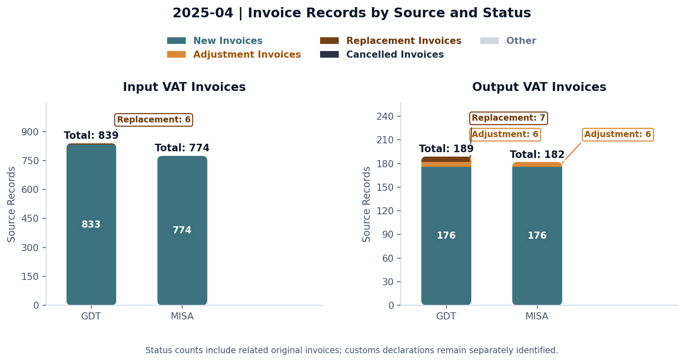
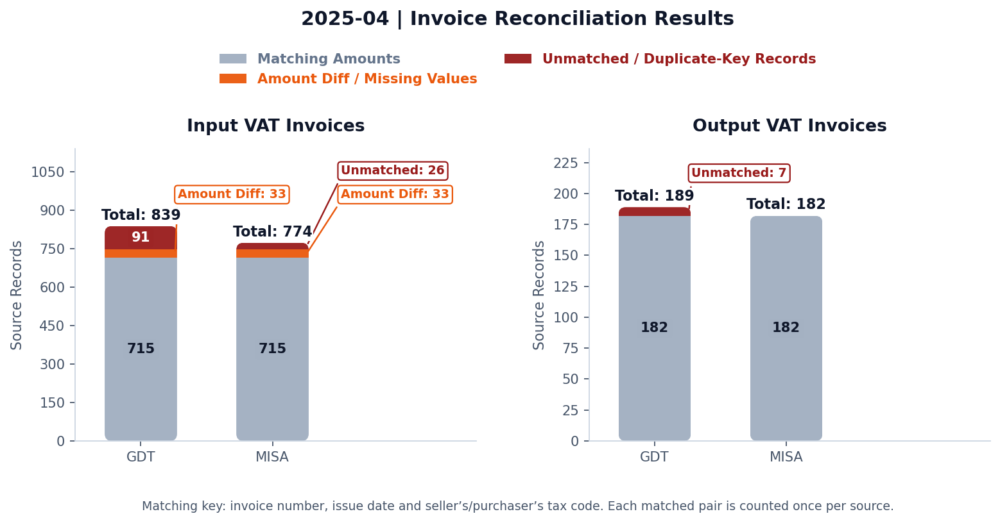

# VAT Invoice Reconciliation Engine

From collecting e-invoices to a focused review of missing records and differences.

## The situation / Before the workflow

The group’s workload covered approximately **1,000 input invoices and 400 output invoices per month across two companies**. **The automation was applied to one company in the group.** The accountant relied on meInvoice’s advertised synchronisation with GDT and assumed the monthly invoice lists were complete.

1. **Check collected e-invoices:** compare documents submitted by staff with the invoices shown in meInvoice and follow up apparent gaps.
2. **Check printed invoices against accounting:** print the e-invoices collected in round one; check for missing invoices and differences in amounts, VAT and other information before preparing the VAT return.

Before building the automation, I manually investigated the records and found gaps in the meInvoice data. Checking documents against an incomplete list could leave invoices outside both rounds of review. Relying on that feed alone was an insufficient completeness control.

Two distinct issues require separate controls:

- **Incomplete synchronisation:** records already on the GDT portal may be absent from meInvoice following a connection interruption. Confirm synchronisation has completed and reconcile the extracts. See [MISA guidance](https://helpact.misa.vn/kb/lam-the-nao-khi-dich-vu-xu-ly-hoa-don-dau-vao-mat-ket-noi-voi-cqt/).
- **Timing differences in supplier reporting:** invoices transmitted after the initial review will be absent from an earlier extract. Refresh the data and investigate subsequent additions before finalising the VAT return.

**2025 regulatory context:** specified suppliers could transmit invoice data by the applicable VAT filing deadline. The 20th relates to monthly filing, not a universal invoice issuance/upload deadline. See [regulatory guidance](https://baochinhphu.vn/nhung-noi-dung-moi-cua-nghi-dinh-so-70-2025-nd-cp-ve-hoa-don-chung-tu-102250903091616929.htm) and [PwC's April 2025 NewsBrief](https://www.pwc.com/vn/en/publications/2025/250416-changes-to-invoicing-regulations.pdf). Decree 254/2026 and Circular 91/2026 replaced the earlier framework from 1 July 2026; apply the rules relevant to the reporting period. See [EY's July 2026 Tax Alert](https://www.ey.com/en_vn/technical/tax/tax-and-law-updates/decree-254-2025-nd-cp-on-electronic-invoices-and-electronic-documents).

## My contribution

After investigating the gaps manually, I automated the download of monthly GDT input and output invoice lists using Python and Playwright, launched from a Windows command line. I built Python reconciliation against the corresponding MISA accounting/VAT schedules, with visual summaries of differences and two Excel reports for the preparer to investigate.

**PowerShell is the launcher; Playwright is the Python browser-automation library.** The PowerShell wrapper in this package is a new convenience launcher for the existing Python exporter, not a claim that the original automation was written in PowerShell.

## Practical value

The preparer can start with the differences and trace them through review workbooks instead of manually comparing every printed invoice with the accounting schedule. The workflow does not establish that every supporting document has been collected, decide deductibility or submit the VAT return.

The invoice printing/checking activity fell from approximately **two hours to 15–20 minutes**, a reduction of approximately **83–88%**. These are actual workflow results confirmed by the project author. The saving applies to this activity, rather than total VAT return preparation; the fictional public dataset illustrates the method and does not measure the workplace time saving.

## Visual overview

The group-wide volumes are distinct from the single-company scope of this case study and its fictional demonstration data.





The case study has a separate **Show Python code** expander beneath each chart. Clicking the chart opens its full-size image.

## Two Excel reports

- [Input VAT report](reports/Input_VAT_Reconciliation_DEMO.xlsx): purchases matched using invoice number, issue date and seller's tax code.
- [Output VAT report](reports/Output_VAT_Reconciliation_DEMO.xlsx): sales matched using invoice number, issue date and purchaser's tax code.

Both have four sheets:

| Sheet | What the preparer reviews |
| --- | --- |
| Matching Reconciliations | Records whose comparison keys and amounts agree under the configured rules. Equivalent fields are consolidated, with source references retained. |
| Mismatch Reconciliations | Paired GDT/MISA records in grouped blocks, with net amount, VAT and invoice-total comparisons. Missing values remain missing. |
| Invoices Only From GDT | GDT records without a corresponding MISA match, for follow-up. |
| Invoices Only From MISA | MISA records outside the matched set, including scope/timing items such as customs declarations and prior-period invoices. |

The input example has 715 agreeing pairs, 33 missing-net-amount review pairs, 91 GDT-only records and 26 MISA-only records. Output has 182 agreeing pairs and seven GDT-only records. A pair is counted once in each source, not twice as unique invoices. Sheet row counts do not equal exception counts because the mismatch sheet uses grouped blocks.

## One demonstration period: April 2025

Use `Purchases_coded_2025-04.xlsx`, `Purchases_no_code_2025-04.xlsx`, `Purchases_cash_register_2025-04.xlsx`, `Sales_electronic_2025-04.xlsx` and `MISA_VAT_Return_Schedules.xlsx` together.

The former four `2026-08` files were byte-identical aliases of the `2025-04` workbooks, not a second August dataset. They have been removed from the current repository to avoid period confusion. The notebook and ZIP use April 2025 files; the historical aliases remain recoverable in Git history.

The April MISA schedule includes six invoices issued before April as intentional review examples. A reporting/schedule period is different from an invoice issue date. These are timing exceptions within the same April reconciliation. The 26 MISA-only records include these six items and 20 illustrative customs declarations.

The demo sales input is electronic-only. The separate live exporter supports both electronic and cash-register sales; do not imply the fictional dataset demonstrates both sales types.

## The notebook and code

[Read the notebook](VAT_Reconciliation_Demo.html) or open [VAT_Reconciliation_Demo.ipynb](VAT_Reconciliation_Demo.ipynb).

The notebook restores the working notebook's visible sequence: configuration, GDT loading/status review, MISA loading/special cases, source/status chart, reconciliation, reconciliation chart and two workbook exports. It does not hide these steps behind `run_demo()`.

Its processing cells follow the working notebook. Public changes are the fictional configuration, relative paths, descriptive guidance and replaced executed outputs. Calculation functions match the working module; public workbook export handling reduces workstation paths to filenames. Generated files go to `generated-reports/2025-04/`, preserving packaged reports. Embedded chart images retain the approved bytes.

```powershell
python -m pip install -r requirements.txt
python -m unittest test_demo test_privacy
```

Run the notebook from this project folder. `vat_reconciliation.py` contains the reusable reading, matching, plotting and export functions. `demo_data_manifest.json` describes the fictional data. `fictional_inputs.json` and the generator are retained for reference; do not regenerate inputs to review this package.

## Automating the GDT download

Files: [PowerShell launcher](export-gdt.ps1), [Python exporter](gdt_export.py), [support functions](gdt_support.py), [dependencies](requirements-gdt.txt).

```powershell
python -m pip install -r requirements-gdt.txt

# Print the search plan without opening a browser or logging in.
.\export-gdt.ps1 -Month '2025-04' -Plan

# For authorised live use, supply the taxpayer and required month.
$vatTaxId = Read-Host 'Taxpayer identifier'
.\export-gdt.ps1 -Month '2025-04' -TaxId $vatTaxId -Mode all

# Equivalent direct Python command:
python .\gdt_export.py --month 2025-04 --tax-id $vatTaxId --mode all
```

The exporter uses installed Microsoft Edge by default. The operator completes login and any CAPTCHA. It searches the selected month, downloads three purchase categories and both sales categories, validates the results and records a run report. Exported files go under `exports/<taxpayer>/<month>/<run>/` and are excluded from publication. No passwords, sessions or real invoice files are supplied.

The older source script covered purchases only. The current Python exporter is included from the local project and supports both directions. A complete authenticated run of that newer exporter has not been verified in this revision; portal changes can affect selectors and downloads. Offline checks and planning do not establish live portal compatibility.

Official references: [Playwright Python](https://playwright.dev/python/docs/library), [download handling](https://playwright.dev/python/docs/downloads).

## Public-data scope

The method is work-informed. Invoice details are fictional and calibrated to retained source counts and reconciliation breakdowns. Aggregates are not independently generated. No original client rows, credentials, invoice lookup links or workstation paths are included. Review labels do not establish tax eligibility or guaranteed compliance.

[View the VAT case study](https://ntxhien25.github.io/vat-reconciliation.html)
